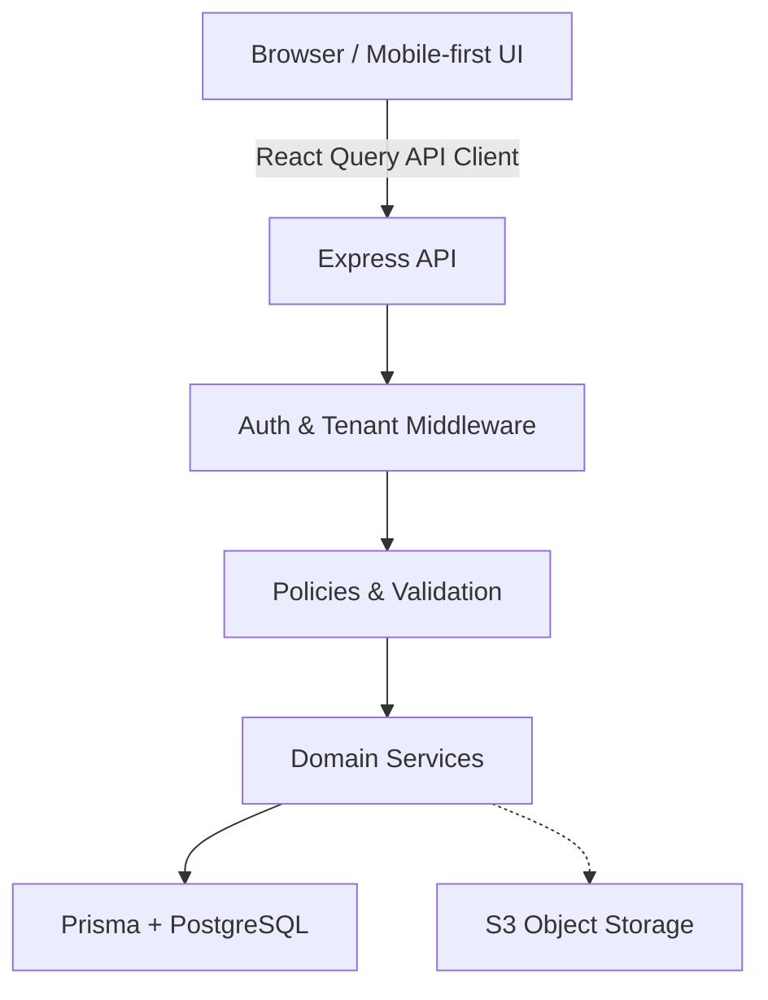

# Target Architecture

## Visão Geral
A arquitetura do Looply V1 prioriza a generalização de domínios (multi-tenant) e a robustez para aplicações B2B. A stack segue baseada em:

## Domain Boundaries
Os módulos na API devem ser divididos em:
- `auth/`: Gerenciamento de tokens, sessões, signup/login e validações.
- `companies/` & `members/`: Controle de multi-tenancy e relacionamentos User-Company.
- `clients/`: Entidades de clientes pertencentes às companies.
- `jobs/` (substitui contents): Central de gerenciamento de trabalho. Interage com `workflows/`.
- `files/`: Upload/Download presigned URL.
- `approvals/`: Ciclo de aprovações com tokens externos criptográficos.
- `activity/`: Audit trail e logs de negócios.

Regra: Nenhum módulo acessa Prisma diretamente sem validar o escopo do tenant, exceto `auth`.

## Tenant Model
- A chave de confiança primária é o `Membership`.
- O contexto do tenant é derivado estritamente do token no backend (o browser envia o token; o backend constrói o contexto de tenant a partir do Member id).

## Auth & Authorization Model
- Autenticação JWT via cookie httpOnly.
- Sessão e Workspace são injetados nas requisições autenticadas.
- Roles Básicas sugeridas: `OWNER`, `ADMIN`, `MEMBER`. Políticas de autorização ficam na camada de serviços (ACL validando `req.user.role` e ownership).

## Job/Workflow
- `Job` passa a ser a entidade genérica para qualquer serviço prestado a um `Client`.
- O Workflow passa a ser estrito. As transições de `WorkflowStage` (antigo status) são geridas pelo backend, rejeitando mudanças impossíveis e garantindo invariantes (ex: não avançar sem arquivos aprovados).

## Activity
- Criação de logs sempre que `Job`, `Workflow`, `Approval` ou `Client` são mutados.
- Modelo simples: `actor, entityType, entityId, action, metadata, timestamp`.

## Files
- Comunicação direta client <-> S3 via Presigned URLs geradas pelo Backend.
- Persistência apenas de metadados na base.

## Approvals
- O processo usa o conceito já estabelecido (tokens aleatórios).
- Segurança extra: rate limits e binding estrito entre tenant e recurso (vínculo token -> JobVersion -> Workspace).

## Frontend Model
- **Server State**: Gerenciado pelo React Query, lidando com chamadas API, caching e refetching.
- **Client State**: Zustand para gerir seleção de workspace e navegação puramente no cliente.
- Mobile-first, sem replicação desnecessária de dados.

## Infraestrutura Mínima (V1)
- React / Vite
- Node / Express
- PostgreSQL + Prisma
- Object Storage (S3-compatible)
- (Opcional/Later) Email/Resend, Pino logger
- (Dispensado por ora) Redis, BullMQ, Socket.io
