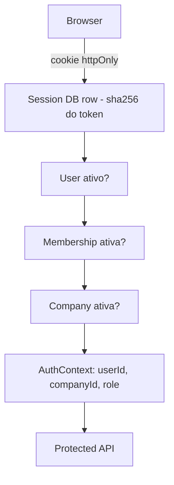

# Auth & Multi-tenancy (B2)

Estado real após a Bateria 2. **Authentication, membership e tenant trust foundation estão implementados. Isolamento por tenant a nível de recurso (Client/Content/etc) permanece pendente e está agendado para B4/B5+.**

## Decisão de arquitetura: sessão DB-backed com cookie httpOnly
- **Escolhido:** Option A — sessão persistente em banco, cookie `looply_session` httpOnly.
- **Motivos:** logout/revogação imediatos (update na row), sem JWT assinado/refresh tokens, sem Redis obrigatório, frontend mínimo (cookie + `credentials: "include"`), testável com fake DB.
- **Token:** 256 bits aleatórios (`crypto.randomBytes`); no banco só o sha256 → leak do DB não produz cookies utilizáveis.
- **Cookie:** httpOnly, SameSite=Lax, `secure` em production, path `/`, maxAge 7 dias.

## Modelo de dados (migration `20260814000000_auth_multitenancy_foundation`)
- `User` += `passwordHash String?` (null = usuário demo sem senha ainda).
- `Company` (id, name, slug? unique, isActive, timestamps) — tenant/workspace.
- `CompanyMember` (userId, companyId, role MemberRole, isActive; `@@unique([userId,companyId])`, índices em userId e companyId).
- `Session` (id = sha256(token), userId, companyId? = workspace ativo, expiresAt, revokedAt?, lastUsedAt?; índice userId).
- FKs `ON DELETE RESTRICT` — sem cascatas destrutivas.
- Migration totalmente aditiva; nenhum dado existente alterado/removido.

## Roles
- `MemberRole`: **OWNER / ADMIN / MEMBER** — menor conjunto que atende os fluxos atuais. O enum antigo `UserRole` (agência) permanece para a listagem de team até B3/B5.
- Primitive: `requireRole("OWNER","ADMIN")` (middleware), policies por recurso entram nas baterias de domínio.

## Senhas
- `node:crypto.scrypt` (64 bytes, salt 16 bytes, `timingSafeEqual`) — sem dependência nova.
- Hash formato `scrypt$<salt>$<hash>`. Nunca logado, nunca retornado.
- Login responde sempre `401 invalid_credentials` ("Credenciais inválidas") para email desconhecido / senha errada / usuário inativo; scrypt roda sempre (dummy hash) para não vazar existência por timing.
- Rate limit login: fixed-window in-process (10 tentativas / 15 min por ip+email) — sem Redis; suficiente para V1 single-node.

## Endpoints
- `POST /api/auth/login` — valida (Zod), cria sessão, seta cookie, retorna `{ user, memberships }` (sem hash/token).
- `POST /api/auth/logout` — revoga sessão, limpa cookie, idempotente.
- `GET /api/auth/me` (requireAuth) — user + memberships ativas + activeCompanyId.
- `POST /api/auth/switch-company` (requireAuth) — companyId do body é apenas *request*; acesso concedido somente com membership ativa.
- Todas as rotas internas `/api/*` (exceto `/api/auth` e `/api/public/*`) agora exigem sessão (`requireAuth`).

## Tenant Context & Trust Model
- `req.auth = { userId, companyId, role }` (explícito, sem AsyncLocalStorage).
- Sequência por request: cookie → session válida (não expirada/revogada) → user ativo → membership ativa (revalidada no banco; session.companyId com fallback para primeira membership ativa) → company ativa.
- `companyId` de body/query/header **nunca** concede acesso.
- Revogação de membership / desativação de user ou company tem efeito imediato (revalidação por request).

## DEV_DEMO_USER — status final
- **Removido.** Nunca existiu middleware de bypass real (era só warning de log); nenhuma rota dependia dele. Frontend não usava demo auth (não buscava current user). Substituído por sessão real; `env.ts`/`server.ts`/`.env.example` limpos.
- Seed cria login demo: todos os usuários `@looply.dev` com senha `looply123` (dev only), company `Looply Studio` e memberships.

## CSRF
- SameSite=Lax + CORS single-origin + JSON only. Sem token CSRF explícito — aceito para V1, revisitar em B3+ se o threat model crescer (ver `.dev-reports/security-audit-2026-08-14.md`).

## Frontend
- `apiFetch` com `credentials: "include"`; `useMe`/`useLogin`/`useLogout`.
- `/login` (novo, mínimo, PT-BR) + `ProtectedRoute` (redirect em 401).
- AppLayout: header mínimo com nome do usuário + "Sair" (sobreposição mínima e preservada sobre diff preexistente).
- Sem duplicação de entidades em Zustand (mantido apenas UI state).

## Gaps de isolamento conhecidos (honestidade)
- Client/Content/Approval NÃO estão bound a Company — qualquer usuário autenticado ainda alcança esses endpoints (autenticado, mas não isolado por tenant). Migração por domínio em B4/B5.
- Team management (criar usuário/membership) ainda não valida role (rota POST /api/team é adição preexistente da worktree, intocada pela B2).

## Segurança — resumo
- Ver `.dev-reports/security-audit-2026-08-14.md`: 0 critical, 0 high, 1 medium (CSRF documentado), 2 low (limiter in-process, sessão sem renewal).
