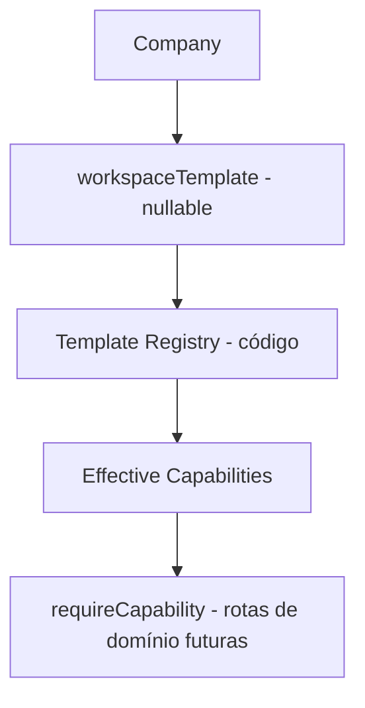

# Workspace Templates + Capabilities (B3)

Estado real após a Bateria 3. **Workspace templates e resolução efetiva de capabilities estão implementados. As features de domínio por trás de cada capability são implementadas nas próximas baterias. O frontend NÃO é template-aware nesta bateria.**

## Princípio de produto
Modularidade no backend + experiência guiada no produto. O usuário escolhe um caso de uso; o sistema resolve as capabilities. Sem plugin framework, sem marketplace, sem editor de módulos, sem overrides por cliente em V1.

## WorkspaceTemplate
- Enum Prisma: `LOCAL_BUSINESS | HIGH_TICKET | MARKETING_AGENCY`.
- `Company.workspaceTemplate` é **nullable** — `null` = workspace provisionado mas não configurado (onboarding B4 pendente). Nenhum valor é inferido silenciosamente.
- Templates são comportamento de produto versionado em código (propriedade da Verbum Lab), não conteúdo de usuário → sem tabela de templates.

## Capability Registry (`backend/src/domain/capabilities.ts`)
- `enum Capability`: CLIENTS, JOBS, WORKFLOW, KANBAN, FILES, APPROVAL, CALENDAR, ACTIVITY, DASHBOARD (9, estáveis).
- `TEMPLATE_REGISTRY`: mapa template → definição. Type-safe, sem strings espalhadas, retorna cópias defensivas.

## Matriz template → capabilities
| Capability | LOCAL_BUSINESS | HIGH_TICKET | MARKETING_AGENCY |
|---|---|---|---|
| CLIENTS | ✓ | ✓ | ✓ |
| JOBS | ✓ | ✓ | ✓ |
| WORKFLOW | ✓ (interno, defaults simples; UI futura esconde complexidade) | ✓ | ✓ |
| KANBAN | — | — | ✓ |
| FILES | ✓ | ✓ | ✓ |
| APPROVAL | — | ✓ | ✓ |
| CALENDAR | ✓ | ✓ | ✓ |
| ACTIVITY | ✓ | ✓ | ✓ |
| DASHBOARD | ✓ | ✓ | ✓ |

Sem divergências vs baseline conceitual do briefing. Defaults por template (workflow preset, experience mode) ficam para as baterias de domínio (B5/B6) — nada especulativo criado.

## Resolver
- `capabilitiesForTemplate(template)` — determinístico; `null/undefined` → `[]` (**nunca** fallback permissivo).
- `hasCapability(template, cap)`.
- `resolveWorkspaceContext(company)` → `{ id, name, template, capabilities, status: ACTIVE|UNCONFIGURED }`.

## Guard (`backend/src/middleware/requireCapability.ts`)
- `requireCapability(Capability.X)`: `req.auth.companyId` (tenant do auth context) → company → template → capability.
- Ausente → **403** `"Recurso não disponível para este workspace"` (consistente com o contrato de autorização existente).
- Ainda não aplicado às rotas atuais de domínio (evitar antecipar B4/B5); disponível como primitive.

## API Contract
- `GET /api/auth/me` agora inclui `workspace: { id, name, template, capabilities, status }` do tenant ativo — resolução oficial é backend-only. Frontend ainda não consome.

## Relação com roles
Capabilities ≠ ACL. Role (MemberRole) controla **quem pode fazer**; capability controla **o que o workspace possui**. Rotas futuras podem exigir ambas (`requireAuth` → `requireCapability` → policy de role).

## Mutabilidade de template
Sem endpoint público de troca. Mudança pós-ativação = operação governada futura (validação contra dados existentes). B4 define o template no onboarding.

## Onboarding (B4) — preparação
`workspaceTemplate = null` já representa "provisionado, onboarding incompleto". Company sem template → zero capabilities de domínio → apenas endpoints de configuração futuros.

## Migration `20260814100000_workspace_templates`
Aditiva: `CREATE TYPE "WorkspaceTemplate"` + `ADD COLUMN "workspaceTemplate"` (nullable). Companies existentes ficam `null` (UNCONFIGURED) exceto a demo (seed seta `MARKETING_AGENCY` — dados demo modelam uma agência; evidência documentada). Rollback não definido/testado.

## Limitações conhecidas
- Rotas de domínio existentes não são capability-guarded ainda (B4/B5+ por domínio).
- Sem defaults por template materializados (B5/B6).
- Guard faz 1 DB read/request, sem cache (aceitável V1).
