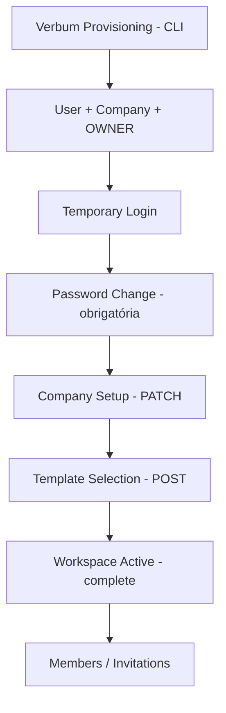

# Provisioning + First-Login Onboarding + Members (B4)

Estado real após a Bateria 4. **Backend de provisioning, contratos de first-login/onboarding e fluxos de members/invitations estão implementados e prontos para a integração frontend futura (Figma). Nenhuma UI foi implementada. Domains de recurso (Clients/Jobs) ainda não são tenant-isolated — Baterias 5+.**

## Ausência de signup público
Nenhuma rota cria User sem provisionamento (CLI operador) ou invitation token.
**B4 remediation final:** o legado `POST /api/team` (que criava Users arbitrários fora dos fluxos aprovados, adição preexistente da worktree) foi neutralizado — agora responde **410 Gone** com contrato claro ("Use convites (/api/invitations)") para QUALQUER role, e `createTeamMember` foi removido do service. `GET /api/team` (listagem read-only) permanece. Testes provam: OWNER/ADMIN/MEMBER não conseguem criar Users pela rota; `user.count()` inalterado; os únicos caminhos de criação de identidade em produção são o provision CLI e o `/api/invitations/accept`.

## Provisioning (Verbum Lab)
- CLI: `backend/src/scripts/provision.ts` (`npx dotenv -e ../.env -- tsx src/scripts/provision.ts "Nome" email@x.com "Empresa"`).
- Sem endpoint HTTP de provisioning (nenhuma superfície de ataque pública; auditor = shell do operador).
- Cria User (senha temporária 96-bit, mustChangePassword=true), Company (workspaceTemplate null = UNCONFIGURED), CompanyMember OWNER.

## Credencial temporária
- `randomBytes(12).toString("base64url")` (~96 bits); hash scrypt no DB; plaintext impresso UMA vez pelo CLI; nunca logado.

## First-login gating (backend-enforced)
- `resolveAuth` retorna `mustChangePassword` → `requirePasswordChanged` bloqueia TODA `/api` normal (403) enquanto pendente.
- Acessíveis nesse estado: `/api/auth/*` e `/api/onboarding/*`.
- `/api/auth/me` e `/api/auth/login` expõem `mustChangePassword`.

## Troca de senha
- `POST /api/auth/change-password` `{newPassword}` (requer sessão; funciona no estado pendente).
- Política: mínimo 10 caracteres (sem regras artificiais de composição).
- Atualiza hash, `mustChangePassword=false`, revoga TODAS as sessões do usuário e emite sessão nova (cookie rotacionado). Senha antiga deixa de autenticar.

## Estado de onboarding
- `User.mustChangePassword` + `Company.workspaceTemplate` (nullable) + `Company.onboardedAt` — flags/timestamps, sem enum acadêmico.
- `GET /api/onboarding/status` → `PASSWORD_CHANGE_REQUIRED | ONBOARDING_REQUIRED | ACTIVE` + `readyToComplete`.

## Dados da empresa
- `PATCH /api/onboarding/company`: name (obrigatório), timezone (default America/Sao_Paulo), locale (pt-BR|en-US), legalName/document/email/phone/website opcionais. Bloqueado após ACTIVE.

## Template / ativação
- `POST /api/onboarding/template` — valida enum dos 3 templates; **só funciona pré-ativação** (após ACTIVE → 409 "operação governada").
- `POST /api/onboarding/complete` — transacional: exige senha trocada + name + template; seta `onboardedAt`; idempotente.
- `requireWorkspaceActive` (middleware) protege rotas de domínio: sessão + senha ok + onboardedAt + template.

## Members & roles
- `GET /api/members` (OWNER/ADMIN), `PATCH /api/members/:id` {role?, isActive?} — OWNER-only.
- Invariantes: empresa sempre ≥1 OWNER ativo (demote/deactivate do último → 409); MEMBER sem gestão; cross-tenant → 404.
- Role matrix V1: OWNER tudo; ADMIN lista/convoca MEMBER; MEMBER nada de gestão.

## Invitations
- Model: token 256-bit, **hash único no DB**, expiresAt (7d), acceptedAt/revokedAt, invitedByUserId, índices companyId/email.
- `POST /api/invitations` (OWNER/ADMIN, workspace ACTIVE; ADMIN só MEMBER; duplicado/membro existente → 409; usa `req.auth.companyId`).
- `GET /api/invitations`, `POST /api/invitations/:id/revoke` (OWNER/ADMIN).
- Delivery por e-mail: deferred (token retornado uma vez ao inviter).

## Accept invitation
- `POST /api/invitations/accept` `{token, name?, password?}`:
  - usuário novo → cria User com senha própria (mustChangePassword=false) + membership (signup invitation-scoped, NÃO público);
  - usuário existente → exige sessão logada com o MESMO e-mail do convite;
  - token inválido/revogado/expirado/replayed → 400 genérico; workspace precisa estar ACTIVE.

## Usuário convidado vs OWNER provisionado
OWNER: senha temporária + onboarding completo. Convidado: escolhe a própria senha, não refaz onboarding (workspace já ACTIVE obrigatório).

## Migração `20260814200000_provisioning_onboarding_members`
Aditiva (User.mustChangePassword, Company fields, Invitation). Backfill demo explícito: company onboardedAt=now (demo operacional completa desde B3), demo users mustChangePassword=false. Rollback não definido/testado.

## Segurança
Ver `.dev-reports/security-audit-b4-2026-08-14.md`: 0 critical/high/medium; 3 low (accept-by-token by design, rate limit no accept, token no response até haver e-mail). CSRF reavaliado: mantenho SameSite=Lax+CORS+JSON como dívida V1 documentada (B2) — sem nova superfície. **Hardening de CSRF/rate-limit pertence à B12 (Hardening + Module Boundaries)** — roadmap revisado: B11 = Dashboard por Template.

## Limitações conhecidas
- Sem envio de e-mail (token manual).
- Sem UI (Figma depois).
- Sem rate limit específico no accept.
- Troca de template pós-ACTIVE = operação governada futura (não implementada).
