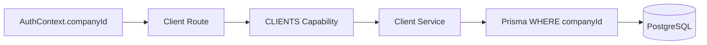

# Clients — Tenant-Scoped Operational Domain (B5)

Estado real após a Bateria 5. **Clients agora pertencem obrigatoriamente a uma Company e todas as operações do domínio são tenant-scoped. Isso não significa que todos os domínios de negócio já estejam isolados: Content/Job e Dashboard pertencem às baterias seguintes.**

## Purpose

Client é a entidade operacional que representa uma empresa atendida pelo workspace. Não é global e não representa ainda um CRM completo.

## Model

`Client` mantém os campos úteis existentes da Demo V1:

- `id`
- `companyId` obrigatório
- `name`
- `brandColor`
- `status` (`ACTIVE`, `INACTIVE`, `PROSPECT`, legado preservado)
- `primaryContactName`
- `primaryContactEmail`
- `primaryContactPhone`
- `channels`
- `createdAt`
- `updatedAt`

`companyId` possui FK para `Company`, índice próprio e política `ON DELETE RESTRICT`.

## Uniqueness

O antigo `name @unique` global foi substituído por `@@unique([companyId, name])`. Dois workspaces podem ter clientes com o mesmo nome; dentro do mesmo workspace o nome continua único.

## Migration and Backfill

Migration: `20260815100000_clients_tenant_scoped`.

Estratégia:

1. Adicionar `companyId` nullable temporariamente.
2. Associar todos os Clients existentes à Company cujo slug é `looply-studio`.
3. Abortar a migration se algum Client permanecer sem Company.
4. Tornar `companyId` `NOT NULL`.
5. Criar FK, índice e unique composto.

Antes: 6 Clients.

Depois: 6 Clients, 0 órfãos, 6 associados à `Looply Studio`.

O backfill é determinístico porque todos os Clients existentes foram criados durante a fase single-tenant Demo V1, quando só havia uma Company operacional correspondente.

## Tenant Trust Model

O tenant vem exclusivamente de `req.auth.companyId`.

Não são aceitos como autoridade:

- `req.body.companyId`
- `req.query.companyId`
- `req.params.companyId`
- `x-company-id`
- capabilities enviadas pelo frontend

O service recebe `companyId` explicitamente e aplica o filtro em todas as operações.

## CRUD

- `GET /api/clients`
- `GET /api/clients/:id`
- `POST /api/clients`
- `PATCH /api/clients/:id`
- `DELETE /api/clients/:id`

Listagem aceita os filtros existentes e mínimos de `status` e `search`, sempre dentro do tenant autenticado.

Lookup por ID usa `findFirst({ where: { id, companyId } })`; recurso de outro tenant retorna 404 para não revelar existência.

Create injeta `companyId` no service. O payload não possui campo de ownership.

Update não permite alterar `companyId` e usa `updateMany({ where: { id, companyId } })`.

## Capability

As rotas usam `requireCapability(Capability.CLIENTS)` depois da cadeia global:

`requireAuth → requirePasswordChanged → requireWorkspaceActive → CLIENTS → handler`.

Os três templates V1 possuem `CLIENTS`, mas o guard é aplicado para manter o boundary arquitetural.

## Roles

OWNER, ADMIN e MEMBER podem usar o domínio operacional de Clients. Gestão administrativa de membros continua separada.

## Delete Semantics

Hard delete só ocorre quando o Client não possui Content vinculado. Caso existam dependências, a API retorna 409 e orienta desativar o Client. Não há cascade destrutivo.

## Content Relation

O Client continua relacionado ao Content legado. B5 não refatora Content para Job.

O caminho de criação de Content agora valida `clientId + companyId`, impedindo anexar novo Content a Client de outro tenant.

Listagens/details completos de Content e aggregates de Dashboard ainda não são declarados tenant-isolated; pertencem a B6/B11.

## Frontend

Zero mudanças. A UI atual é somente alvo de regressão; a integração definitiva virá do Figma.

## Known Gaps

- Content/Job ainda precisa de ownership própria e isolamento completo.
- Dashboard ainda possui aggregate global de Clients.
- POST legado de Team foi fechado na remediação B4; não foi reaberto.
- CSRF/rate-limit hardening pertence à B12.
