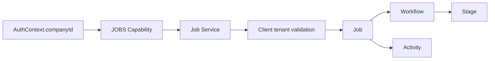
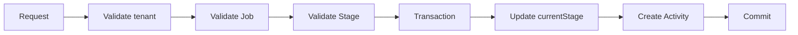

# Jobs + Workflow + Activity (B6)

Estado real após a Bateria 6. **Job é o domínio operacional canônico; Workflow/Stage validam transições no backend; Activity persiste histórico tenant-scoped. Files, Approval, Calendar, Dashboard e views Kanban continuam em baterias posteriores.**

## Content → Job Strategy

Foi escolhida a opção C com generalização no código e preservação física:

- Prisma agora expõe `Job` em vez de `Content`.
- Prisma agora expõe `JobVersion` em vez de `ContentVersion`.
- `Job @@map("Content")` e `JobVersion @@map("ContentVersion")` preservam tabelas e IDs.
- Approval mantém suas colunas físicas e relações compatíveis, mas aponta para os modelos canônicos `Job`/`JobVersion`.
- `/api/jobs` é o contrato canônico.
- `/api/contents` permanece adapter legacy, usa os delegates `job` e a mesma base tenant-scoped; não existe uma segunda tabela ou lógica de negócio paralela.

Essa estratégia não perdeu rows, IDs, Client links, versões ou Approval links.

## Job Model

O Job preserva os campos úteis do antigo Content (`title`, `clientId`, formato, notas, datas legadas, versões e Approval compatibility) e adiciona:

- `companyId` obrigatório;
- `lifecycleStatus`: `OPEN`, `IN_PROGRESS`, `COMPLETED`, `CANCELLED`;
- `workflowId`;
- `currentStageId`.

O antigo `status` é preservado para compatibilidade com o fluxo legado de aprovação/publicação. Ele não substitui o lifecycle macro nem o Stage operacional novo.

## Migration

Migration: `20260816100000_jobs_workflow_activity`.

Estratégia:

1. Criar enums `JobLifecycleStatus` e `ActivityType`.
2. Adicionar `companyId`, `lifecycleStatus`, `workflowId`, `currentStageId` à tabela física `Content`.
3. Backfill de `Content.companyId` usando `Content.clientId → Client.companyId`.
4. Abortar se algum row ficar sem Company.
5. Aplicar `companyId NOT NULL`, FK e índices.
6. Criar `WorkflowDefinition`, `WorkflowStage` e `Activity`.
7. Criar workflows/stages default para Companies configuradas.
8. Associar Jobs existentes ao primeiro Stage do workflow da Company.

Não houve reset, truncate, delete ou troca de IDs.

## Data Preservation

Snapshot imediatamente antes da migration:

- Companies: 5
- Clients: 7
- Contents/Jobs: 8
- ContentVersions/JobVersions: 10
- Approvals: 36

Após a migration:

- Jobs: 8
- JobVersions: 10
- Approvals: 36
- Jobs órfãos: 0
- Workflows bootstrapados: 2
- Stages bootstrapados: 8

Os dois workflows correspondem às Companies configuradas (`MARKETING_AGENCY` e `HIGH_TICKET`). Companies sem template permanecem sem workflow default até configuração.

## Tenant Ownership

Job possui `companyId NOT NULL` com FK para Company e `clientId NOT NULL` com FK para Client.

O service valida sempre:

`Client.id + Client.companyId === req.auth.companyId`.

O body não pode fornecer ownership. `workflowId` e `stageId` também são validados contra o tenant e o workflow do Job.

## Job CRUD

Endpoints canônicos:

- `GET /api/jobs`
- `GET /api/jobs/:id`
- `POST /api/jobs`
- `PATCH /api/jobs/:id`
- `POST /api/jobs/:id/transition`
- `GET /api/jobs/:id/activity`

Cross-tenant lookup retorna 404. Não há hard delete de Job nesta bateria; o lifecycle suporta `CANCELLED`.

## Workflow

Modelos:

- `WorkflowDefinition`: um workflow default por Company, tenant-owned.
- `WorkflowStage`: stages ordenados por `position`, pertencentes ao workflow.

Endpoints mínimos:

- `GET /api/workflows`
- `GET /api/workflows/:id`

Não foi criado builder visual, engine BPMN ou plugin framework.

## Template Defaults

| Template | Stages |
|---|---|
| `LOCAL_BUSINESS` | Novo → Em andamento → Concluído |
| `HIGH_TICKET` | Novo → Em andamento → Revisão → Concluído |
| `MARKETING_AGENCY` | Backlog → Em produção → Revisão → Concluído |

Os defaults são determinísticos e definidos em `domain/jobWorkflow.ts`.

## Bootstrap / Idempotency

`ensureDefaultWorkflow(companyId)`:

- exige Company ativa e template configurado;
- retorna o workflow existente se já houver;
- cria exatamente um workflow com stages default quando necessário;
- usa unique `WorkflowDefinition.companyId`;
- trata corrida de primeira criação recuperando o row criado pela outra requisição.

Jobs existentes foram associados ao primeiro Stage durante a migration. Jobs novos recebem workflow e stage no create.

## Transition Rules

`POST /api/jobs/:id/transition` recebe apenas `{ stageId }`.

Valida:

- Job pertence ao tenant;
- Job possui workflow;
- Stage pertence ao mesmo workflow;
- Workflow pertence ao tenant;
- Stage está ativo;
- destino é diferente do stage atual.

Qualquer Stage ativo do mesmo workflow é permitido como destino; não há adjacency matrix especulativa.

Lifecycle status e Stage são conceitos separados. A transição de Stage não altera automaticamente o lifecycle macro.

## Activity

Model:

- `id`
- `companyId`
- `jobId`
- `actorUserId?`
- `type`
- `metadata?`
- `createdAt`

Tipos B6:

- `JOB_CREATED`
- `JOB_UPDATED`
- `JOB_STAGE_CHANGED`
- `JOB_COMPLETED`
- `JOB_CANCELLED`

Metadata permanece pequeno. Stage transition armazena `fromStageId` e `toStageId`; Job create armazena o stage inicial. Request bodies e secrets não são persistidos.

## Transaction Boundaries

Job creation:

`create Job + JOB_CREATED Activity` na mesma transaction.

Stage transition:

`update currentStage + JOB_STAGE_CHANGED Activity` na mesma transaction.

Lifecycle update também registra Activity na mesma transaction. Testes simulam falha do insert de Activity e confirmam rollback do Job/stage.

## Capabilities

- `/api/jobs`: `Capability.JOBS`.
- `/api/jobs/:id/transition`: `Capability.WORKFLOW`.
- `/api/jobs/:id/activity`: `Capability.ACTIVITY`.
- `/api/workflows`: `Capability.WORKFLOW`.
- Legacy `/api/contents` e `/api/publications`: `Capability.JOBS`.

Capabilities permanecem separadas de roles. OWNER/ADMIN/MEMBER podem operar Jobs; configuração futura de workflow poderá restringir alterações administrativas.

## Legacy Compatibility

`/api/contents` não é mais backed por Prisma `content`; usa o modelo Prisma `Job` mapeado à tabela física `Content`. Recebe `req.auth.companyId` em todas as operações, aplica `JOBS` capability e bootstrapa workflow/activity na criação legacy.

O nome legacy e os campos de Approval/publicação permanecem somente para compatibilidade incremental. O domínio canônico para novas integrações é `/api/jobs`.

## Approval, Files, Calendar and Dashboard

- Approval: relação física preservada; comportamento completo pertence à B9.
- Files/media: preservados como campos legacy; implementação pertence à B8.
- Calendar/publication dates: preservados; Calendar pertence à B10.
- Dashboard: delegates foram adaptados de `content` para `job` apenas para manter o build; aggregates tenant-safe completos pertencem à B11.
- Kanban: não implementado; stages são primitivas de domínio para B7 consumir.

## Frontend

Zero mudanças. Nenhuma tela, rota visual, Kanban ou React Query novo foi implementado.

## Known Gaps

- Approval public-token paths ainda não possuem o hardening tenant-aware completo; B9.
- Dashboard ainda possui aggregates globais; B11.
- Content/Job legacy routes ainda expõem campos antigos de social media; limpeza semântica futura deve preservar Approval/Files.
- Nenhum workflow configurável por UI foi criado.
- CSRF/rate-limit hardening pertence à B12.
