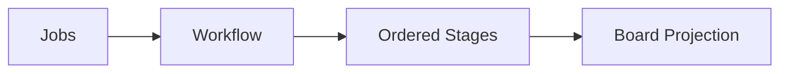
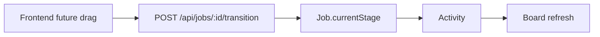

# Operational Views (B7)

Estado real após a Bateria 7. **O backend expõe projeções tenant-safe de lista, board e summary para Jobs. Kanban continua sendo uma projeção de Workflow/Stage; nenhuma UI ou persistência de Kanban foi criada.**

## List Projection

`GET /api/jobs` retorna uma projeção mínima de Job:

- id/title;
- Client mínimo;
- lifecycleStatus/status legacy;
- Workflow mínimo;
- Stage atual mínimo;
- createdAt/updatedAt;
- `total`, `page`, `limit`, `pages`.

O endpoint é tenant-scoped e limitado a 100 rows por página.

## Filters

Filtros B7:

- `clientId`;
- `workflowId`;
- `stageId`;
- `lifecycleStatus`;
- `search` por Job title ou Client name.

Nenhum filtro aceita `companyId` como autoridade.

## Sorting

Campos permitidos:

- `updatedAt` (default);
- `createdAt`;
- `title`.

Direção aceita apenas `asc`/`desc`. Não há column name arbitrário nem SQL raw.

## Pagination

List usa offset/page simples:

- default: 50;
- máximo: 100;
- `page` mínimo: 1.

Não foi introduzido cursor framework.

## Board Projection

`GET /api/jobs/board` retorna:

- Workflow ativo;
- stages ordenados;
- jobs agrupados pelo `currentStageId`;
- count por stage;
- `unassignedCount` explícito.

`GET /api/jobs/board?workflowId=...` permite consultar um Workflow do próprio tenant. Workflow estrangeiro retorna 404.

Board não cria estado, não move Jobs e não registra Activity.

## Summary Counts

`GET /api/jobs/summary` retorna:

- `byStage`;
- `byLifecycle`.

Ambos usam `groupBy` com `companyId` obrigatório.

Summary não é Dashboard gerencial; métricas de conversão, SLA, produtividade e performance ficam para B11.

## Capability Enforcement

- List: `JOBS`.
- Board: `JOBS + WORKFLOW + KANBAN`.
- Summary: `JOBS + WORKFLOW`.
- Transition: `JOBS + WORKFLOW`.
- Activity history: `JOBS + ACTIVITY`.

LOCAL_BUSINESS e HIGH_TICKET podem usar list/summary/workflow, mas sem `KANBAN` o board retorna 403. MARKETING_AGENCY possui `KANBAN` e pode consumir o board.

## Template Behavior

O backend não possui `if template === ...` nas rotas. O registry de capabilities determina acesso. Os stages continuam definidos pelo workflow default criado na B6.

## Projection Strategy

List e board usam selects mínimos. Board executa uma query de Workflow e uma query de Jobs, sem N+1 por stage ou card. Summary executa duas queries `groupBy` em paralelo.

## Unassigned Jobs

Jobs sem `currentStageId` não são silenciosamente enviados ao primeiro stage. O board os omite dos buckets e informa `unassignedCount`.

Jobs novos e rows migrados pela B6 recebem stage; o bucket é uma defesa para corrupção/legacy futuro.

## Transition Relationship

Board é read-only. A única escrita de Stage continua sendo:

`POST /api/jobs/:id/transition` com `{ stageId }`.

Essa operação valida tenant, Job, Workflow e Stage, altera `currentStageId` e cria Activity atomicamente.

## Query Efficiency

- List: count + findMany paralelos, `take <= 100`.
- Board: Workflow + Job findMany, sem query por stage.
- Summary: dois groupBy paralelos.
- Card projection não carrega Activity completa, versões, Approval ou media.

O board permanece sem paginação por ser uma projeção completa do workflow. Esse é um risco de volume baixo conhecido e será revisitado com dados reais.

## Index Review

B7 reutiliza índices existentes em:

- `Job.companyId`;
- `Job.clientId`;
- `Job.workflowId`;
- `Job.currentStageId`;
- `Job.status`;
- `Client.companyId`;
- `WorkflowDefinition.companyId`;
- `WorkflowStage.workflowId`.

Nenhuma migration foi criada em B7.

## Legacy Compatibility

`/api/contents` continua bridge tenant-safe, mas não possui `/api/contents/board`. Novas projeções usam `/api/jobs`.

## Frontend

Zero mudanças. Nenhum componente, hook, rota, estilo ou tradução Figma foi implementado.

## Known Gaps

- Kanban UI e drag-and-drop pertencem ao frontend futuro/B7 visual posterior.
- Board ainda não tem windowing/paginação por stage.
- Dashboard pertence à B11.
- Files, Approval e Calendar pertencem às B8/B9/B10.
- CSRF/rate-limit hardening pertence à B12.
