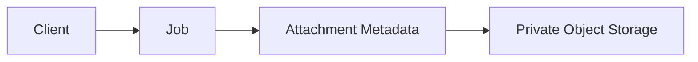
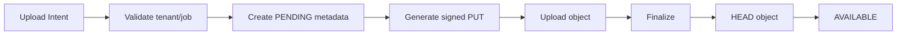
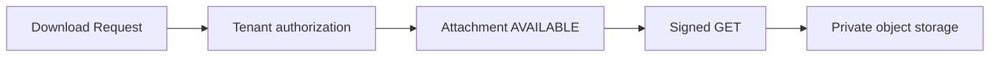

# Files + Storage (B8)

Estado real após a Bateria 8. **Job attachments persistem metadata tenant-owned no PostgreSQL e bytes em object storage S3-compatible privado. Upload/download usam URLs presigned e autorização backend. Nenhuma UI foi implementada.**

## Existing Media / Storage Inventory

- Não existia SDK S3/MinIO, storage client, multer ou rota de upload.
- Não existe filesystem permanente de uploads.
- `JobVersion` mantém `mediaUrl` e `mediaType` legados.
- A UI antiga usa URLs externas/metadata de media; nenhum byte local foi encontrado.
- Não havia `storageKey`, presigned URL, bucket ou base64 persistido.

## Architecture Decision

Database owns metadata and authorization. Object storage owns bytes.

Foi escolhida uma integração S3-compatible mínima com AWS SDK v3:

- PUT presigned direto do cliente para o bucket;
- GET presigned curto após autorização backend;
- HEAD no finalize;
- DELETE server-side;
- sem abstraction layer multi-provider ou registry de providers.

## Storage Provider

Provider: S3-compatible via `@aws-sdk/client-s3` e `@aws-sdk/s3-request-presigner`.

Configuração:

- `STORAGE_ENDPOINT` opcional para S3-compatible/MinIO;
- `STORAGE_REGION` default `us-east-1`;
- `STORAGE_BUCKET`;
- `STORAGE_ACCESS_KEY`;
- `STORAGE_SECRET_KEY`;
- `STORAGE_FORCE_PATH_STYLE`;
- `STORAGE_PRESIGN_TTL_SECONDS` default 600.

Sem bucket/credenciais, as rotas falham fechado com 503 `storage_unavailable`. Não há fallback para disco local e `/health` não depende de storage.

## Schema Changes

Migration: `20260817100000_job_attachments`.

Model `JobAttachment`:

- `id`;
- `companyId` obrigatório;
- `jobId` obrigatório;
- `uploadedByUserId?`;
- `storageKey` unique;
- `originalName`;
- `contentType`;
- `sizeBytes`;
- `status` (`PENDING`, `AVAILABLE`, `FAILED`);
- `etag?`;
- timestamps.

FKs:

- Company `RESTRICT`;
- Job `CASCADE`;
- User `SET NULL`.

Indexes:

- `(companyId, jobId)`;
- `(jobId, status)`;
- unique `storageKey`.

## Migration

Aditiva. Não existiam attachments/metadata para migrar. Jobs e media legados permaneceram intactos. Migration aplicada, Prisma Client gerado e schema diff vazio após aplicação.

## Attachment Model

O domínio B8 é JobAttachment, não um framework polymorphic genérico. O arquivo sempre pertence a um Job nesta bateria.

## Tenant Ownership

`companyId` deriva de `req.auth.companyId`.

Todas as operações resolvem:

`attachment/job/company` dentro do tenant.

Body, query, storageKey e uploadedBy não são autoridades.

## Job Relationship

Upload intent exige `Job.id + companyId`. Job de outro tenant retorna 404. Attachment também possui Company explícita para filtros e defesa em profundidade.

## Storage Key

Gerada exclusivamente pelo backend:

`company/{companyId}/jobs/{jobId}/{uuid}`

O filename original nunca é usado como path. A key não é retornada nas respostas públicas de metadata/listagem.

## Upload Contract

`POST /api/jobs/:jobId/files/upload-intent`

Input:

- `originalName`;
- `contentType`;
- `sizeBytes`.

Response:

- `file` metadata;
- `uploadUrl` presigned PUT;
- `headers` esperados;
- `expiresAt`.

O limite máximo é 50 MB. O Node não recebe nem armazena os bytes.

## Upload State

- `PENDING`: metadata criada, objeto ainda não confirmado.
- `AVAILABLE`: finalize confirmou objeto.
- `FAILED`: reservado para falha permanente futura; não há state machine extensa.

Upload intent expirado permanece PENDING até cleanup posterior.

## Finalize Contract

`POST /api/files/:id/complete`

Backend:

1. resolve attachment por `id + companyId`;
2. retorna estado atual se já `AVAILABLE`;
3. executa HEAD usando storageKey do banco;
4. rejeita objeto ausente;
5. valida tamanho exato;
6. valida content type quando o provider retorna o valor;
7. salva `AVAILABLE` e ETag informativo.

Não confia em `uploaded: true` enviado pelo cliente.

## Download Contract

`GET /api/files/:id/download`

Exige auth, Company correta e status `AVAILABLE`. Retorna URL GET presigned curta. Não retorna bucket URL permanente, storage credentials ou storageKey.

Content-Disposition usa filename sanitizado e encoded, sem CR/LF.

## List Contract

`GET /api/jobs/:jobId/files`

Retorna apenas metadata mínima:

- id;
- jobId;
- originalName;
- contentType;
- sizeBytes;
- status;
- etag;
- createdAt.

Não executa HEAD por item e não expõe storageKey.

## Delete Semantics

`DELETE /api/files/:id`

1. resolve metadata por tenant;
2. apaga objeto usando storageKey server-side;
3. remove metadata com filtro `id + companyId`.

Se o object delete falhar, metadata permanece para retry. Se a remoção do DB falhar após o object delete, pode existir orphan object; reconciliação fica para hardening/operations futura. Delete de objeto S3 é idempotente no provider.

## Legacy Media Strategy

`mediaUrl`/`mediaType` legados em JobVersion foram preservados. Não houve cópia de bytes, migração falsa de URL para Attachment ou remoção de metadata. Novos uploads usam exclusivamente JobAttachment/object storage.

## Capability Enforcement

Todas as rotas B8 exigem:

`requireAuth → requirePasswordChanged → requireWorkspaceActive → FILES → handler`.

Job ownership continua sendo validado pelo service. Não há checks diretos de template nas rotas.

## Role Behavior

OWNER, ADMIN e MEMBER podem listar, iniciar, finalizar, baixar e remover attachments operacionais de Jobs nesta V1. Policies mais restritivas podem ser adicionadas quando Approval/B9 definir necessidades.

## Limits

- Max upload metadata: 50 MB.
- Filename: trim, remove control chars, máximo 255 chars.
- Content type: obrigatório, máximo 160 chars.
- Presigned URL: bounded entre 60 e 900 segundos, default 600.

## Presigned URL Security

- bucket privado;
- key específica;
- método específico;
- TTL curto;
- sem wildcard/prefix credentials;
- sem access key/secret em response;
- sem public-read ACL.

## Tests

Fake storage tests cobrem:

- key server-generated;
- cross-tenant Job;
- size limit;
- finalize object missing/mismatch/success/idempotency;
- minimal metadata;
- pending download rejection;
- cross-tenant download/delete;
- object delete + metadata delete.

## Security

Security audit: `.dev-reports/security-audit-b8-2026-08-14.md`.

- Critical: 0
- High: 0
- Medium: 0
- Low: 1 (storage não configurado retorna 503 fail-closed).

Runtime dependency audit sem dev dependencies: 0 vulnerabilidades.

## Performance

- Upload direto ao object storage;
- list apenas PostgreSQL metadata;
- nenhum HEAD durante list;
- download assina apenas o arquivo solicitado;
- sem N+1 storage calls.

Ver `.dev-reports/performance-audit-b8-2026-08-14.md`.

## Smoke / Provider Availability

Não há endpoint/bucket S3-compatible configurado neste ambiente. Portanto não foi alegado smoke real de PUT/GET. O fluxo completo foi validado com fake storage adapter; as rotas reais falham 503 de forma explícita quando storage não está configurado.

## Approval Boundary

Nenhum arquivo foi tornado público e nenhum token de Approval foi alterado. Acesso público a arquivos pertence à B9.

## Frontend

Zero mudanças. Upload UI, preview, progress e download button permanecem Figma-driven.

## Known Gaps

- Sem storage provider local configurado neste ambiente.
- Sem cleanup de PENDING expirado.
- Sem orphan reconciliation.
- Sem multipart uploads.
- Sem antivirus/content scanning.
- Sem files de Client/Company sem Job.
- Sem public Approval file access.
