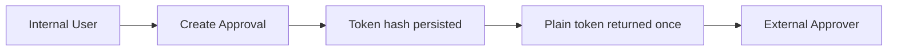
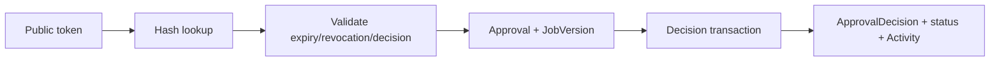
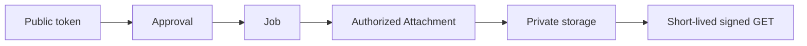

# Approval (B9)

Estado real após a Bateria 9. **Approval agora é tenant-owned, usa tokens públicos hasheados, decisões imutáveis com histórico e acesso a arquivos controlado por Approval. Nenhum frontend ou email delivery foi implementado.**

## Existing Approval State

Antes da B9:

- 38 Approval rows;
- token plaintext hex de 64 chars armazenado no DB;
- sem `companyId` explícito;
- sem expiry/revocation/decidedAt;
- sem decision history;
- Approval apontava para Job/JobVersion físicos compatíveis;
- routes públicas usavam `where: { token }`;
- respostas públicas carregavam dados excessivos;
- sem file authorization por Approval.

## Migration Strategy

Foi adaptado o modelo existente, sem recriar Approvals:

1. adicionar `companyId`, `tokenHash`, `expiresAt`, `revokedAt`, `decidedAt`;
2. derivar Company via `Approval.jobId → Job.companyId`;
3. hashear tokens existentes com `SHA-256` via `pgcrypto`;
4. definir expiry de compatibilidade como `createdAt + 30 dias`;
5. validar zero rows incompletos;
6. remover plaintext `token`;
7. adicionar `ApprovalDecision` e `ApprovalAttachment`.

IDs, Job links, JobVersion links, statuses, feedback e timestamps foram preservados.

## Approval Model

- `companyId` obrigatório;
- `contentId` físico preservado, representando `Job`;
- `contentVersionId` físico preservado, representando `JobVersion`;
- `tokenHash` unique;
- `status`: `PENDING`, `APPROVED`, `CHANGES_REQUESTED`, `REJECTED`, `REVOKED`;
- `feedback`;
- `clientName`;
- `clientReviewedAt`;
- `expiresAt`;
- `revokedAt?`;
- `decidedAt?`.

## Tenant Ownership

Approval é filtrado por Company. Job e JobVersion são validados antes da criação. Version deve possuir `contentId` igual ao Job solicitado.

## Version Relationship

Create Approval aceita `versionId` opcional. Sem ele, usa a versão mais recente do Job. Com ele, resolve `JobVersion.id + Job.id`; versão de outro Job retorna 404.

Uma decisão fica vinculada à versão específica e não muda retroativamente quando o Job recebe outra versão.

## Internal Approval API

- `POST /api/jobs/:jobId/approvals`
- `GET /api/jobs/:jobId/approvals`
- `GET /api/approvals/:id`
- `POST /api/approvals/:id/revoke`

Todas exigem `APPROVAL` capability, auth, senha trocada e workspace ativo.

Create retorna o token plaintext uma única vez junto ao link. O token não é persistido nem logado.

## Approval Lifecycle

- `PENDING`: decisão ainda possível.
- `APPROVED`: decisão final.
- `CHANGES_REQUESTED`: decisão final desta rodada; nova versão/Approval futura pode ser criada.
- `REJECTED`: decisão final.
- `REVOKED`: revogado internamente.

Expiry é derivado de `expiresAt`, sem worker/cron.

## Public Token Model

- 256-bit random token;
- plaintext somente na criação interna;
- DB armazena apenas SHA-256 em `tokenHash`;
- lookup público hasheia o token recebido;
- nenhum Approval ID funciona como credencial.

Request logger redige o token no path para `/api/public/approvals/...`.

## Token Lifecycle

Token deixa de permitir acesso quando:

- expirado;
- revogado;
- Approval finalizado, para decisões conflitantes.

GET público continua disponível enquanto o token estiver válido, inclusive após decisão. Writes conflitantes retornam 409; replay da mesma decisão é idempotente.

## Public Read Contract

`GET /api/public/approvals/:token` retorna somente:

- Approval id/status/expiry;
- Job title e Client name mínimo;
- JobVersion caption/media metadata;
- decision history mínima;
- attachments explicitamente associados e AVAILABLE.

Não retorna Company metadata, tokenHash, storageKey, memberships, Activity privada, internal notes ou outros Approvals.

Token inválido, expirado ou revogado retorna 404 genérico.

## Decision Contract

- `POST /api/public/approvals/:token/approve`
- `POST /api/public/approvals/:token/request-changes`
- `POST /api/public/approvals/:token/reject`

`CHANGES_REQUESTED` exige feedback. Approve/reject aceitam reviewer name opcional; email pode ser adicionado pelo service contract.

## Decision History

`ApprovalDecision` persiste:

- Approval;
- decision;
- comment;
- actorName;
- actorEmail;
- actorType (`PUBLIC`);
- createdAt.

Histórico anterior ao B9 não é fabricado. Status existente é preservado; decisões novas criam rows explícitos.

## Replay / Concurrency

Decision update usa condição atômica:

- status PENDING;
- sem revokedAt;
- sem decidedAt;
- expiresAt futuro.

Se outra decisão venceu, o update count é zero. Mesma decisão retorna idempotente; decisão diferente retorna 409.

## Activity Integration

Novos eventos:

- `APPROVAL_REQUESTED`;
- `APPROVAL_APPROVED`;
- `APPROVAL_CHANGES_REQUESTED`;
- `APPROVAL_REJECTED`;
- `APPROVAL_REVOKED`.

Metadata contém apenas approvalId/versionId. Approval create/revoke/decision registram Activity na mesma transaction.

## File Authorization

Arquivo público só é acessível pela cadeia:

`token → Approval → ApprovalAttachment → JobAttachment → Company/Job → AVAILABLE`.

Endpoint:

`GET /api/public/approvals/:token/files/:fileId/download`

Não existe `/api/public/files/:id/download`. FileId estrangeiro, Approval diferente, Job diferente, token expirado/revogado ou status PENDING retornam 404/erro seguro.

## Storage Integration

Reutiliza B8 `getObjectStorage()` e presigned GET. Bucket continua privado, storageKey não aparece na resposta e storage ausente resulta em 503 após autorização.

## Capability Enforcement

Rotas internas exigem `Capability.APPROVAL`. High Ticket e Marketing Agency possuem capability conforme registry B3; templates sem capability recebem 403. Public token não depende de sessão/capability, pois o token é a credencial externa.

## Role Behavior

OWNER, ADMIN e MEMBER podem criar/listar Approvals operacionais nesta V1. Revogação também usa a mesma capability/tenant chain; RBAC mais restritivo fica para evolução futura.

## Legacy Compatibility

`/api/public/approvals/:token` permanece o contrato público, mas agora usa hash/lifecycle/response mínimo. `contentService.sendForApproval` chama o mesmo `createApproval` service. Não existem dois modelos públicos paralelos.

## Token Logging

O request logger substitui tokens públicos no path por `[redacted]`. O token plaintext só aparece no response de criação interna e não é enviado ao logger.

## Performance

- Public read usa projection mínima;
- file download gera somente um presigned GET;
- list não executa HEAD por arquivo;
- decision não possui N+1;
- índices em tokenHash, companyId/contentId e decision history.

Ver `.dev-reports/performance-audit-b9-2026-08-14.md`.

## Frontend

Zero mudanças. Public approval page, buttons, comments, file preview e dashboard interno permanecem Figma-driven.

## Known Gaps

- Email delivery não implementado.
- Rate limit específico de Approval público pertence à B12.
- Histórico anterior ao B9 não possui Decision rows fabricados.
- Storage real não configurado no ambiente atual.
- Approval/Job status orchestration permanece explícita; não há transição automática de Workflow Stage.
