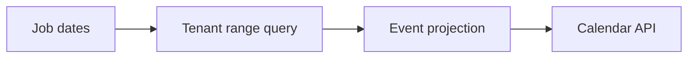
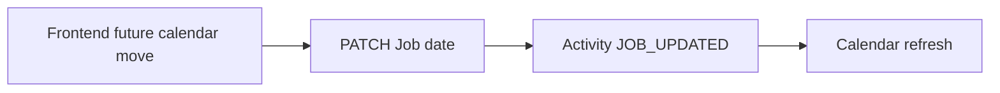

# Calendar (B10)

Estado real após a Bateria 10. **Calendar é uma projeção tenant-safe de datas canônicas do Job. Não existe CalendarEvent persistido, UI, recorrência ou integração externa.**

## Date Inventory

Job/legacy Content possui:

- `publicationTarget`: data planejada de publicação/entrega;
- `scheduledAt`: data/hora de agendamento operacional;
- `publishedAt`: fato histórico de publicação;
- `createdAt`/`updatedAt`.

Não existem `dueAt`, `dueDate`, `startAt`, `endAt` ou CalendarEvent.

Uso atual:

- `publicationTarget`: 6 de 8 Jobs;
- `scheduledAt`: 3 de 8 Jobs;
- `publishedAt`: 2 de 8 Jobs.

## Architecture Decision

Reutilizar os campos existentes. Não adicionar `dueAt` ou novo modelo de evento sem requisito concreto. Calendar apenas projeta `publicationTarget` e `scheduledAt`.

`publishedAt` permanece histórico e não entra na projeção futura principal.

## Legacy Date Strategy

Não houve migration de datas nem renomeação destrutiva. `publicationTarget` e `scheduledAt` continuam compatíveis com `/api/publications` e com o bridge legacy `/api/contents`.

Eventos derivados:

- `PUBLICATION_TARGET` ← `publicationTarget`;
- `SCHEDULED` ← `scheduledAt`.

Um Job com ambas as datas gera dois eventos distintos.

## Schema Changes

Nenhuma alteração de schema foi necessária em B10.

## Timezone Policy

DB mantém `DateTime` em UTC. API recebe ISO-8601 e filtra instantes absolutos. `Company.timezone` é retornado no contrato para interpretação futura da UI e boundaries locais; B10 não faz matemática de calendário local nem adiciona biblioteca de timezone.

## Range Semantics

`from` e `to` são obrigatórios e usam intervalo `[from, to)`:

- início incluído;
- fim exclusivo;
- `from < to`;
- range máximo de 90 dias.

Datas inválidas, invertidas ou maiores que 90 dias retornam 400.

## Calendar API

`GET /api/calendar?from=...&to=...`

Filtros opcionais:

- `clientId`;
- `stageId`;
- `lifecycleStatus`.

Resposta:

- `timezone` do workspace;
- `range` normalizado em UTC;
- `events`;
- `totalEvents`;
- `truncated`.

## Event Projection

Cada evento retorna apenas:

- id derivado estável;
- jobId;
- type;
- at;
- title;
- Client mínimo;
- lifecycleStatus;
- Stage mínimo.

Não retorna Activity, Approval history, Files, versions ou media.

## Event Types

- `PUBLICATION_TARGET`;
- `SCHEDULED`.

`publishedAt` não é projetado como evento futuro.

## Filters

Todos os filtros são combinados com `companyId` do auth context. Client estrangeiro ou Stage estrangeiro retorna 404. `companyId` enviado na query é ignorado.

## Result Limits

- range máximo: 90 dias;
- máximo de Jobs consultados: 501;
- máximo de eventos retornados: 500;
- `truncated` informa se o cap foi atingido.

Não há paginação/token em B10.

## Job Date Mutation

`PATCH /api/jobs/:id` é a autoridade de escrita para `publicationTarget` e `scheduledAt`. O Calendar não possui endpoint de escrita, drag-specific endpoint ou CalendarEvent mutation.

Datas inválidas são rejeitadas. Alterações continuam dentro da Activity `JOB_UPDATED` do Job service.

## Capability Enforcement

`GET /api/calendar` usa:

`requireAuth → requirePasswordChanged → requireWorkspaceActive → CALENDAR → handler`.

O registry B3 atualmente possui CALENDAR nos três templates. Nenhum check direto de template foi adicionado.

## Tenant Isolation

Tenant é sempre `req.auth.companyId`. Calendar nunca lista Jobs de outra Company, mesmo com Client/Stage/companyId spoofados.

## Query Strategy

Uma query de Job com OR temporal, filtros tenant-safe, select mínimo e `take=501`. Não há query por dia, Client, Stage ou evento.

## Index Review

B10 reutiliza índices existentes em `companyId`, `clientId`, `currentStageId`, `workflowId` e status. Nenhum índice especulativo foi criado. Índices temporais podem ser avaliados após EXPLAIN/volume real.

## Legacy Publication Compatibility

`/api/publications` permanece inalterado como bridge tenant-safe. Não foi criado `/api/publications/calendar`. Calendar canônico usa `/api/calendar` e os mesmos campos de Job.

## Frontend

Zero mudanças. Não foram implementados month/week/agenda views, date picker, drag-and-drop, hooks ou styling.

## Known Gaps

- Sem dueAt/dueDate genérico; adicionar somente com requisito posterior.
- Sem paginação/windowing após 500 eventos.
- Sem recorrência.
- Sem Google/Outlook/ICS.
- Dashboard pertence à B11.
- CSRF/rate-limit hardening pertence à B12.

## Appointment Projection (A1.2)

O Calendar agora inclui a projeção de `Appointment` além de `Job`. 
- **Event Type:** `APPOINTMENT`.
- **Cancellation:** Somente status `SCHEDULED` são incluídos. `CANCELLED` são sumariamente ignorados do calendário.
- **Interval Overlap:** O Calendar respeita interseção de intervalos de agendamentos (`startsAt < to && (endsAt == null || endsAt > from)`), tratando agendamentos com `endsAt` como blocos contínuos.
- **Tenant Isolation:** Mantém total isolamento via `companyId`.
- **Global Merge & Cap:** Consultas isoladas limitadas a 501 eventos por fonte garantem que a junção final, ordenada deterministicamente no backend, respeite com sucesso o teto inalterado de 500 eventos totais. O uso da flag `truncated` agora reflete estritamente se o total global ultrapassa 500 eventos.
- **Performance bounds:** As consultas de origem (`Job` e `Appointment`) são independentes, com escopo e teto definidos, sem N+1. Tudo é integrado, ordenado e capado em memória limitada (máximo ~1000 elementos avaliados).
