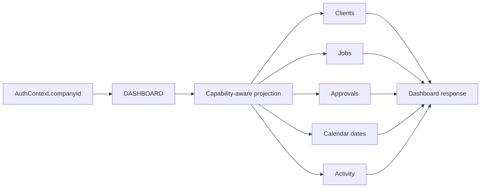
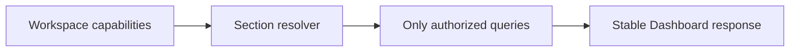

# Dashboard by Template (B11)

Estado real após a Bateria 11. **Dashboard é uma projeção operacional tenant-safe e capability-aware. Não existe modelo Prisma de Dashboard, analytics warehouse, cache ou UI nesta bateria.**

## Previous Global Gaps

Antes da B11, `dashboardService` usava:

- `db.job.groupBy` sem Company;
- `db.job.count` sem Company;
- `db.client.count` sem Company;
- `db.user.count` global;
- status counts globais;
- recent Jobs globais.

Todos foram substituídos por queries tenant-scoped.

## Architecture Decision

Dashboard é projeção pura. Não há `Dashboard`, `DashboardWidget`, `MetricSnapshot`, cache table, materialized view ou analytics store.

Route única:

`GET /api/dashboard`

O frontend atual recebe campos legacy preservados, além do contrato novo.

## Dashboard Contract

Resposta contém:

- `workspace`;
- `capabilities`;
- `availableSections`;
- `summary`;
- `attention`;
- `upcoming` opcional;
- `recent`;
- `counts` legacy tenant-scoped;
- `recentContents` legacy bounded;
- `needingAttention` legacy bounded.

## Metric Definitions

### Clients

`summary.clients.active`:

- fonte: `Client.status = ACTIVE`;
- filtro: `companyId` autenticado;
- capability: `CLIENTS` é parte do domínio, mas a query é feita somente para workspace autenticado e ativo.

### Jobs

Fonte: `Job.lifecycleStatus`, sempre com `companyId`:

- `open`: `OPEN`;
- `inProgress`: `IN_PROGRESS`;
- `completed`: `COMPLETED`;
- `cancelled`: `CANCELLED`;
- `total`: soma dos lifecycle groups.

### Team

`summary.team.active` é o count de `CompanyMember.isActive = true` da Company atual. Não é count global de Users.

### Stage

`summary.byStage` usa `Job.currentStageId` e nomes de `WorkflowStage`, somente quando `WORKFLOW` está disponível.

### Legacy counts

`counts.draft`, `inReview`, `approved`, `scheduled`, `published` usam o status legacy do Job, sempre filtrado por Company, para compatibilidade com a shell antiga.

## Attention Definitions

`attention.jobs` contém até 10 Jobs com status legacy `AWAITING_CLIENT` ou `CHANGES_REQUESTED`.

`attention.pendingApprovals` e `changesRequestedApprovals` contam somente Approvals da Company atual, não revogados e não expirados, quando `APPROVAL` existe.

`attention.upcoming` usa uma janela fixa de agora até 7 dias, por meio da projeção de Calendar B10, quando `CALENDAR` existe.

Não existe `overdue`: B10 não possui `dueAt` genérico e Dashboard não inventa prazo a partir de `createdAt`.

## Capability-Aware Sections

- sempre: `summary`, `attention`, `recent`;
- `WORKFLOW`: `stages`;
- `KANBAN`: `board` disponível como seção futura;
- `APPROVAL`: `approvals`/approval attention;
- `CALENDAR`: `upcoming`;
- `ACTIVITY`: recent activity.

Se a capability não existe, a seção é omitida e a query correspondente não é executada. Não são retornados zeros falsos para domínios indisponíveis.

## Local Business Projection

Mantém uma projeção simples: Clients ativos, lifecycle Jobs, atenção operacional, upcoming e Activity. Não recebe seção board/Approval porque o registry não concede KANBAN/APPROVAL.

## High Ticket Projection

Possui atenção de Approval/review, upcoming, Activity, lifecycle e stages de Workflow. Não recebe board porque High Ticket não possui KANBAN.

## Marketing Agency Projection

Possui maior densidade operacional: approvals, upcoming, Activity, stages e seção `board` disponível por capability KANBAN. Ainda não existe UI board nesta bateria.

Não existem services forks por template.

## Tenant Isolation

Todas as queries usam `companyId` derivado do `req.auth` recebido pela route. `companyId`, template e capabilities vindos de query/body não são autoridades.

## Query Strategy

As seções independentes executam em paralelo com `Promise.all`. Recent Jobs e attention Jobs têm limite 10. Activity tem limite 10. Upcoming usa janela fixa de 7 dias e Calendar cap de 500.

Não são carregados Files, storage, Approval history completo, versões completas ou Activities ilimitadas.

## Index Review

B11 reutiliza índices existentes de Client.companyId, Job.companyId/currentStageId/workflowId/status, Approval.companyId, Activity.companyId/jobId e WorkflowStage.workflowId. Nenhuma migration foi criada.

## Security

Dashboard requer `Capability.DASHBOARD` depois de auth/password/workspace. Approval metrics não são consultadas sem `APPROVAL`; Activity/Calendar/Workflow seguem o mesmo princípio.

## Performance

Ver `.dev-reports/performance-audit-b11-2026-08-14.md`.

- queries independentes paralelas;
- listas bounded;
- sem N+1;
- sem storage calls;
- sem cache prematuro.

## Frontend

Zero mudanças. Dashboard UI, cards, charts, widgets, hooks, routes e Figma translation permanecem fora da B11.

## Known Gaps

- Dashboard não é analytics/reporting platform.
- Não há overdue universal.
- Não há métricas de SLA/produtividade/conversão.
- Não há cache/materialized views.
- Hardening geral pertence à B12.
