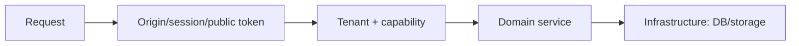
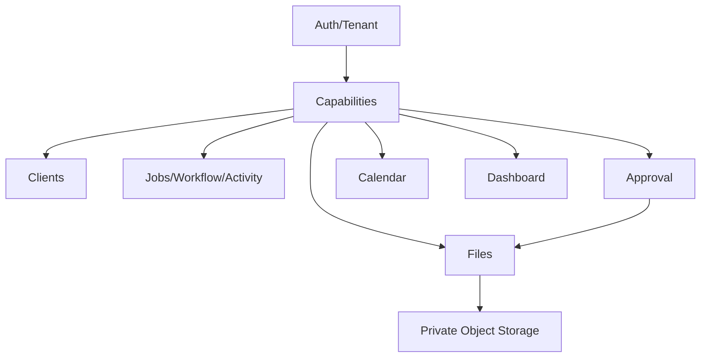

# Looply V1 — Hardening & Production Readiness

Estado real após a Bateria 12. **O backend está pronto para staging com os pré-requisitos operacionais explicitamente listados abaixo. Nenhum deploy de produção foi executado. Frontend/Figma permanece separado.**

## Security Model

- Sessão DB-backed em cookie httpOnly/Secure production/SameSite=Lax.
- Tenant derivado de Membership/session.
- Resources usam Company scope.
- Capabilities são server-side.
- Public Approval usa token SHA-256, não sessão.
- Storage bucket privado e URLs presigned curtas.

## Tenant Isolation

Auditoria repository-wide confirmou que os domínios principais filtram Company. Dashboard global foi corrigido em B11. Client/Job/Workflow/Stage/Activity/Attachment/Approval/Dashboard possuem filtros tenant-safe nos caminhos canônicos.

## Capability Matrix

| Domain | Capability |
|---|---|
| Clients | `CLIENTS` |
| Jobs | `JOBS` |
| Workflow/transition | `WORKFLOW` |
| Board | `JOBS + WORKFLOW + KANBAN` |
| Files | `FILES` |
| Approval internal | `APPROVAL` |
| Calendar | `CALENDAR` |
| Dashboard | `DASHBOARD` |
| Activity history | `ACTIVITY` |

Frontend nunca envia capabilities como autoridade.

## CSRF

Mutations unsafe (`POST`, `PUT`, `PATCH`, `DELETE`) com cookie aceitam:

- Origin igual ao `CORS_ORIGIN`; ou
- Referer com mesma origin; ou
- ausência de ambos para clientes não-browser/CLI.

Origin estrangeira retorna 403. Public Approval token routes não usam cookie e ficam fora do guard CSRF.

SameSite=Lax, HttpOnly, Secure production e CORS exact-origin continuam ativos.

## CORS

Express usa `origin: env.CORS_ORIGIN` e `credentials: true`. Wildcard `CORS_ORIGIN=*` é rejeitado por `validateEnv`.

## Sessions / Cookies

- HttpOnly;
- Secure em production;
- SameSite=Lax;
- path `/`;
- expiry 7 dias;
- logout revoga;
- change-password revoga sessões anteriores;
- membership/user/company inactive são revalidados por request.

## Rate Limiting

- Login: limiter B2 existente, agora responde 429 através do contrato comum.
- Public Approval writes: 20/15 min por IP + token hash lógico.
- Public Approval reads: 60/15 min por IP + token hash lógico.
- Invitation accept: 20/15 min por IP + token hash lógico.
- Chaves de limiter são SHA-256; plaintext token não vai para logs.
- Limiter é in-memory e single-node; distributed Redis não foi introduzido.

## Proxy / Client IP Trust

`TRUST_PROXY=false` por default. Produção atrás de um único reverse proxy deve configurar `TRUST_PROXY=true`; sem isso, o limiter usa o IP observado diretamente. Não há confiança implícita em `X-Forwarded-For`.

## Public Route Inventory

| Route | Auth model | Protection |
|---|---|---|
| `/health` | public liveness | no DB/storage dependency |
| `/health/ready` | public readiness | DB check |
| `/api/auth/login` | public credential | CSRF origin + login limiter |
| `/api/auth/logout` | session | CSRF origin |
| `/api/auth/change-password` | session | CSRF origin + auth |
| `/api/onboarding/*` | session | auth/onboarding rules |
| `/api/invitations/accept` | invitation token | CSRF origin + rate limit |
| `/api/public/approvals/*` | approval token | token hash/lifecycle + rate limit on reads/writes |
| `/api/*` domain routes | session | auth/password/workspace/capability |

Public Approval is mounted before the session auth wall intencionalmente.

## Public Approval Security

- 38 existing plaintext tokens migrated to SHA-256 hashes.
- Plaintext token column removed.
- Existing links receive 30-day compatibility expiry.
- Decisions are conditional, immutable and historized.
- Conflicting replay returns 409; same replay is idempotent.
- Token paths are redacted in application logs.

## Token Logging

Request logger redacts `/api/public/approvals/<token>` to `/api/public/approvals/[redacted]`. Deployment contract requires reverse proxy/access logs to avoid persisting plaintext Approval tokens. Nginx was not modified in B12.

## Files / Storage

- PostgreSQL owns JobAttachment metadata.
- Private S3-compatible storage owns bytes.
- storageKey is server-generated.
- presigned PUT/GET are bounded.
- `AVAILABLE` requires storage HEAD verification.
- no local disk/base64/public bucket.
- absent storage config fails feature requests with 503, not health.

## Storage Operational Gate

Real PUT → HEAD/finalize → GET → DELETE smoke was **not executed** because no provider credentials/bucket are configured in this environment. Files are not production-ready until this smoke passes against the configured private bucket.

## Upload Cleanup / Reconciliation

`npm --prefix backend run attachments:reconcile`:

- marks PENDING attachments older than 24h as FAILED;
- scans up to 500 AVAILABLE objects;
- HEADs storage objects and marks missing metadata FAILED.

It fails closed when storage is not configured. No scheduler/queue was added.

## Query Limits

- Jobs list: max 100;
- Board: bounded projection with current known volume;
- Calendar: 90-day range, max 500 events;
- Dashboard: recent/attention/activity max 10;
- Approval decisions/files: max 100 per projection;
- Attachments: max 100 per Job;
- upload: 50 MB;
- presigned URLs: 60–900 seconds.

## Legacy Bridges

- `/api/contents`: logical Job bridge, tenant/capability scoped; remove after Figma frontend consumes `/api/jobs`.
- `/api/publications`: legacy publication projection, tenant/capability scoped; remove after calendar/frontend migration.
- Dashboard legacy fields: preserved but now tenant-scoped; remove after frontend migration.
- legacy mediaUrl/mediaType: preserved until attachment/frontend migration.

## Module Boundaries

- Auth/Tenant provides identity/context.
- Capability middleware protects domains.
- Dashboard reads domains but domains do not import Dashboard.
- Calendar reads Job dates; Job does not depend on Calendar.
- Approval may use Attachment/storage authorization; Files does not depend on Approval.
- Storage is infrastructure and does not know UI/domain policy.
- No cycles requiring DI container were introduced.

## Environment Requirements

Required runtime:

- `DATABASE_URL`;
- valid `PORT`;
- exact `CORS_ORIGIN`;
- `PUBLIC_APP_URL`.

Feature-specific storage:

- `STORAGE_BUCKET`;
- `STORAGE_ACCESS_KEY`;
- `STORAGE_SECRET_KEY`;
- optional endpoint/region/path style/TTL.

`TRUST_PROXY=true` only behind one trusted proxy.

Secrets are never printed by validation.

## Health / Readiness

- `/health`: process liveness, no DB/storage dependency.
- `/health/ready`: DB readiness.
- Storage readiness is separate operational gate; no bucket HEAD per health request.

## Logging / Redaction

Logger is structured JSON. Redacts password/token/cookie/authorization/secret/API keys. Approval URL token paths are explicitly redacted. Signed URLs/storage credentials are not logged by B8/B9/B12 paths.

## Dependency Security

- Backend runtime audit (`npm audit --omit=dev`): 0 vulnerabilities.
- Full backend audit: dev-tool vulnerabilities remain (Vitest/Vite/esbuild); Vitest UI is not used in production and no forced major upgrade was applied.
- Frontend runtime audit has moderate React Router advisories; frontend is explicitly outside B12/Figma scope and requires a separate compatibility upgrade decision.
- No `npm audit fix --force` executed.

## Database / Migrations

- Prisma migration status: up to date.
- Prisma schema validate: PASS.
- Schema diff: empty after B12 changes.
- No B12 migration created.
- DB invariants checked: Client/Job/Approval/Attachment Company IDs, tokenHash unique, storageKey unique, no orphan Approval/Job ownership.

## Production Proxy Contract

Before production:

- HTTPS only;
- exact API proxy `/api` behavior;
- no plaintext Approval token access logging;
- `TRUST_PROXY` aligned with one trusted proxy;
- sane request body limits;
- security headers preserved;
- forwarded headers not trusted from direct public clients;
- direct-to-storage upload path available.

Nginx was not modified.

## Frontend Boundary

Zero frontend changes. Figma integration remains the next product integration step after B12.

## Looply → Kore Future Boundary

No integration code was added. Future integration must use explicit versioned API/event contracts, separate auth/session boundaries, no shared DB coupling and no shared tenant session assumption.

## Production Readiness Checklist

- [x] HTTPS requirement documented
- [x] Exact CORS origin
- [x] Secure cookie in production
- [x] CSRF Origin/Referer guard and tests
- [x] Login rate limit
- [x] Invitation rate limit
- [x] Public Approval rate limits
- [x] Public token redaction in app logger
- [x] No plaintext Approval token in DB
- [x] Tenant isolation tests
- [x] Capability tests
- [x] Migrations/schema diff validated
- [x] Backend runtime dependency audit
- [x] Storage private contract
- [ ] Real storage PUT/HEAD/GET/DELETE smoke
- [ ] Production storage credentials/bucket
- [x] Public bucket disabled by implementation contract
- [x] Frontend origin configuration documented
- [ ] Backup/restore procedure supplied by operations
- [x] Logs avoid secrets
- [x] Seed is command-only, not startup side effect
- [x] Health/readiness reviewed
- [x] Nginx/proxy contract documented
- [x] No production deploy performed in B12

## Known Accepted Risks

- In-memory rate limits reset on process restart and do not coordinate replicas.
- Dev-only package vulnerabilities remain pending a safe dependency upgrade.
- Frontend runtime dependency audit has moderate advisory requiring separate compatibility work.
- PENDING cleanup/reconciliation is operational command-only.
- Board/calendar/approval/attachment pagination uses bounded caps, not cursors.

## Final Readiness Classification

**READY WITH OPERATIONAL PREREQUISITES**

Code/tests/schema/security contracts are green for staging. Production requires HTTPS/proxy setup, private storage credentials and real storage smoke, backup/restore procedure, and final frontend/Figma integration.
